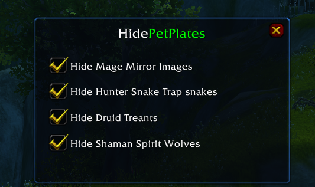

# HidePetPlates

[English](README.md)

Un addon chico para World of Warcraft **3.3.5a** que oculta las placas de nombre de las mascotas temporales, así en arenas y campos de batalla solo ves las placas que importan.

## Qué puede ocultar

- **Imágenes Espejo del mago**: llevan el nombre del mago, así que el addon las distingue del mago real por el color de la placa.
- **Serpientes de la Trampa de Serpientes del cazador** (Víbora / Serpiente venenosa)
- **Entes del druida** (Fuerza de la naturaleza)
- **Lobos espirituales del chamán** (Espíritu feral)

Cada uno tiene su propia casilla. Los cambios se aplican al instante, sin `/reload`.

## Uso

Escribí `/hpp` para abrir el menú.

## Instalación

1. Descargá el repositorio (**Code → Download ZIP**).
2. Copiá la carpeta `HidePetPlates` en `World of Warcraft\Interface\AddOns`.
3. Reiniciá el juego o escribí `/reload`.

Funciona con clientes en inglés, español, francés, alemán y ruso.
