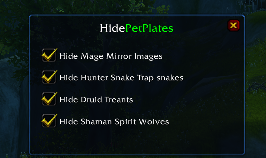

# HidePetPlates

[Español](README.es.md)

A small World of Warcraft **3.3.5a** addon that hides the nameplates of temporary pets, so in arenas and battlegrounds you only see the plates that matter.

## What it can hide

- **Mage Mirror Images**: they carry the mage's name, so the addon tells them apart from the real mage by the color of the plate.
- **Hunter Snake Trap snakes** (Viper / Venomous Snake)
- **Druid Treants** (Force of Nature)
- **Shaman Spirit Wolves** (Feral Spirit)

Each one has its own checkbox. Changes apply right away, without `/reload`.

## Usage

Type `/hpp` to open the menu.

## Installation

1. Download the repository (**Code → Download ZIP**).
2. Copy the `HidePetPlates` folder into `World of Warcraft\Interface\AddOns`.
3. Restart the game or type `/reload`.

Works on English, Spanish, French, German and Russian clients.
